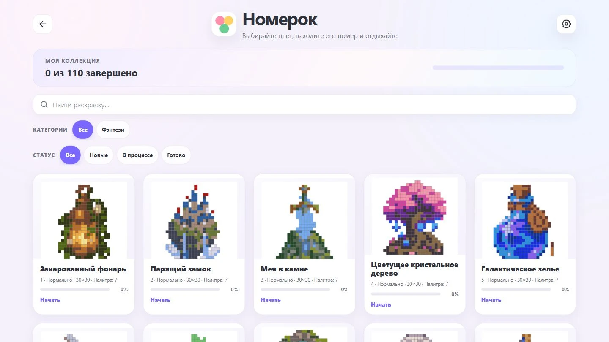
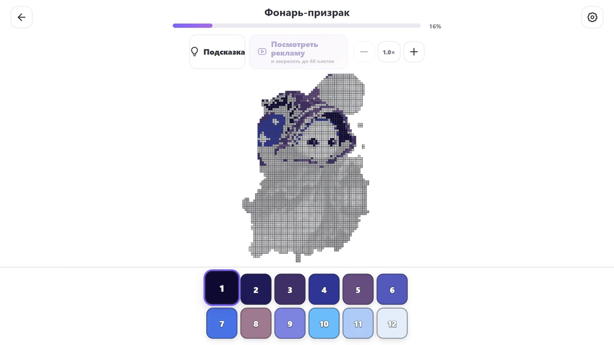

# Номерок / Numbi

Номерок — уютная пиксельная раскраска по номерам. Numbi — a relaxing pixel color-by-number game. Каждый рисунок собран из одинаковых квадратных клеток: до окрашивания внутри стоит номер, а пиксели разных будущих цветов различаются собственными серыми оттенками. Mobile-first интерфейс написан на React + TypeScript + Vite, работает без backend и поддерживает tap/drag painting, zoom/pan, подсказки, rewarded/fullscreen ads, завершение уровня и RU/EN.

Production-каталог содержит 120 пиксельных раскрасок (239 528 клеток) с прогрессией 24×24 → 90×90. React загружает лёгкий manifest, PNG-превью — лениво, а клетки — только для открытого уровня.

## Скриншоты





Кадр игрового процесса взят из записи игры.

## Старт, обучение, награды и аудио

Стартовый экран: «Играть» (первая незавершённая картинка), «Продолжить» (последняя начатая, с поиском по времени прогресса, если последняя открытая уже закончена), «Выбор картинок», «Настройки». Слева — оптимизированный детальный исходник замка, `public/art/menu-castle.png`; подготовка: `node scripts/prepare-menu-art.mjs`.

При первом входе в раскраску показывается overlay из шести коротких шагов: палитра, tap/drag, zoom/pan, бесплатная подсказка, добровольная реклама, завершение. Пропуск и окончание сохраняют `settings.tutorialCompleted` в Save V3. Повтор: Настройки → Как играть. RU/EN поддержаны, клавиатурный фокус удерживается внутри диалога.

Rewarded зависит от сложности: 10/15/25/40/60 правильных пикселей для уровней 1–5. Если цвет закончен — выбирается следующий незавершённый; если весь остаток меньше награды — закрашивается остаток. Награда применяется непосредственно в SDK `onRewarded`, однократно. Закрытие, ошибка и запоздавший callback награды не дают. Fullscreen остаётся только при выходе из completion-экрана, после двух завершений и не чаще одного успешного показа за 120 секунд. Официальный sticky banner включён только на Start/Catalog (включая Settings поверх них) и скрыт в gameplay, tutorial, completion и перед rewarded/fullscreen; запросы рекламы сериализованы и дедуплицированы.

Отдельные `settings.music` и `settings.sound` сохраняются локально и в Player Data. Оригинальные спокойные минорные ambient-заготовки: `public/audio/menu.wav`, `public/audio/gameplay.wav` (24 секунды каждая, PCM mono 22050 Hz, вместе 2.12 MB). Их можно заменить своими loop-треками под теми же именами. Воспроизводимая генерация: `node scripts/generate-audio.mjs`. И музыка, и SFX воспроизводятся через Web Audio (`AudioBufferSourceNode`/осцилляторы), без `HTMLAudioElement`, поэтому игра не регистрирует системный медиаплеер. Звук запускается после действия игрока, отключается при рекламе, настройках, обучении, потере фокуса, скрытии вкладки и SDK pause. Причины паузы независимы: возвращение фокуса не отменяет SDK pause.

## Прогрессивная детализация

| Уровни | Сетка | Максимум цветов |
| --- | --- | --- |
| 1–10 | 24×24 | исходные палитры |
| 11–25 | 30×30 | 7 |
| 26–50 | 45×45 | 9 |
| 51–75 | 65×65 | 9 |
| 76–100 | 75×75 | 12 |
| 101–120 | 90×90 | 12 |

`progressiveGrid: true` в `content/imports/defaults.json` включает presets из `gridForOrder()`. Уровни 121+ пока используют 90×90; расширение каталога не требует изменения runtime. `import.json.grid` переопределяет preset. Сложность 1–5 вычисляется по размеру, числу игровых клеток и числу цветов, либо задаётся `import.json.difficulty`. В manifest записаны difficulty, gridSize, regionCount, colorCount; карточка показывает сложность, сетку и палитру. Порядок стабилен по `order`; число занятых клеток внутри диапазона зависит от силуэта.

110 исходных изображений повторно обработаны через Sharp с новой сеткой; это не растягивание готовых 20×20. Первые 10 ручных пиксельных рисунков перенесены 20→24 nearest-neighbor с сохранением авторских форм и старых region ID. Повторяемый одноразовый скрипт: `scripts/upgrade-starter-grids.mjs`.

Максимальный zoom — 12×, стартовый масштаб растёт с сеткой. SVG-ячейки мемоизированы, нормализация прогресса кэшируется по неизменяемым объектам. Текущие 120 одновременно начатых картинок помещаются в ~88.22 KiB Save V3. При расширении до 300 крупных сеток нужно повторить проверку размера Player Data; 300-entry catalog fixture сам по себе проверяет только каталог.

Импорт сообщает художественные предупреждения (в основном отдельные светлые/цветные пиксели в детальных исходниках), не ошибки. Их можно просмотреть в `qa/catalog.html`; детали не удаляются автоматически. `npm run qa:complexity` создаёт таблицу всех 120 уровней в `qa/level-complexity.tsv`; score учитывает число клеток и цветов, плотность, цветовые границы, изолированные клетки и мелкие компоненты. Порядок меняется только внутри неизменных difficulty/grid-групп, поэтому stable ID и геометрия сохранений не меняются.

## Development

Требуется Node.js 20.19+.

```bash
npm ci
npm run dev
```

`predev` автоматически проверяет и компилирует содержимое `content/levels/`. Live watch этой папки намеренно не добавлен: после изменения ассета перезапустите dev server или выполните `npm run build:levels`. Это сохраняет pipeline простым и одинаковым с production.

Локальный `/sdk.js` без dev proxy может вернуть 404. Игра в этом случае работает в local-only режиме без рекламы и Player Data. Для проверки настоящего SDK используйте официальный Yandex Games SDK dev proxy или черновик игры.

## Production build

```bash
npm run build:levels
npm run test
npm run validate:levels
npm run build
```

На свежей копии проекта `npm run build:levels` создаёт каталог `public/generated/`, который читают тесты.

`npm run build` через `prebuild` заново запускает `build:levels`, затем TypeScript-check и Vite. Результат появляется в `dist/`. `base: './'` обеспечивает относительные ссылки на JS, CSS и generated content внутри архива.

Общая проверка:

```bash
npm run build:levels
npm run check
```

## Yandex build

```bash
npm run build:yandex
```

Команда не использует старую сборку: она пересобирает уровни и приложение, проверяет распакованный размер `dist/`, создаёт кроссплатформенным Node-скриптом `release/numbi-yandex-final.zip`, распаковывает ZIP для аудита и проверяет наличие `index.html`, JS, CSS и manifest без лишней папки `dist/`. В архив никогда не входят исходные картинки, `content/`, `qa/`, `src/`, `tests/`, cache, `node_modules`, WebP или source maps.

`npm run audit:yandex` запускает статическую предрелизную проверку source levels, manifest, production links, PNG-промо, размера распакованного build и содержимого final ZIP. При обновлении промо выполните `npm run prepare:promo`, чтобы сохранить RGB PNG без alpha.

Отдельная проверка лимита Яндекс Игр:

```bash
npm run check:yandex-size
```

Скрипт считает распакованное содержимое `dist/` и показывает вклад HTML/CSS/JS,
compiled levels, PNG thumbnails и прочих файлов. До 70 000 000 bytes статус healthy,
70–80 МБ — warning, 80–95 МБ — strong warning, а начиная ровно с внутреннего
лимита 95 000 000 bytes build завершается ошибкой. Также выводится оценка
runtime-размера для 300 уровней на основе текущего среднего.

## Yandex SDK

`index.html` подключает рекомендуемый для загружаемого архива `<script src="/sdk.js"></script>`. Интеграция сосредоточена в `src/services/yandexSDK.ts`:

- безопасная инициализация `YaGames.init()` с local fallback;
- язык из `ysdk.environment.i18n.lang`;
- `LoadingAPI.ready()` только после manifest, initial save и доступного интерактивного UI;
- `GameplayAPI.start()` только в активной незавершённой раскраске;
- `GameplayAPI.stop()` в каталоге, настройках, completion modal, рекламе и паузе;
- `game_api_pause`, `game_api_resume` и `visibilitychange`;
- rewarded-награда только после callback `onRewarded`;
- fullscreen ad с лимитом по завершениям и времени;
- официальный sticky banner с состоянием Start/Catalog ON и Gameplay OFF;
- `ysdk.deviceInfo()` как источник desktop/mobile/tablet/tv root-class;
- account-selection events из `ysdk.EVENTS`.

Любой отсутствующий необязательный метод SDK обрабатывается без падения и потери локального прогресса.

## Save system

Browser storage key `quiet-colors-save-v1` и Player Data key `quietColorsSave` намеренно не переименованы вместе с игрой: это сохраняет уже созданные данные пользователей.

Текущий sparse save имеет `version: 3`. Закрашенные пиксели хранятся как bitset (`Uint8Array → Base64`), а не как сотни строковых ID:

```json
{
  "version": 3,
  "levels": {
    "flower": {
      "paintedMask": "AAgAQA==",
      "completed": false,
      "contentVersion": 1,
      "updatedAt": 1720000000000
    }
  },
  "settings": {
    "sound": true,
    "language": "auto",
    "updatedAt": 1720000000001
  },
  "meta": {
    "lastPlayedLevelId": "flower",
    "updatedAt": 1720000000002
  }
}
```

Индекс клетки: `row * max(30, gridWidth) + column`. Старые сетки сохраняют stride 30, новые 90×90 требуют максимум 8100 bits (~1013 bytes до Base64). Текущая геометрия имеет contentVersion 2 и `previousContent` для версии 1: завершённые картинки сохраняют completed, частичная маска переносится по нормализованным координатам. Исправленные уровни 041–049 имеют contentVersion 3 без миграции: их прежний контент был другой картинкой, поэтому старый частичный прогресс безопасно сбрасывается. Процент может немного отличаться из-за детализации силуэта. Неизвестные несовместимые версии безопасно сбрасываются; перед второй публичной сменой геометрии потребуется цепочка миграций.

Save не содержит title, palette, manifest, SVG или пустых записей для неоткрытых уровней. Старые `version: 1` и `version: 2` с `paintedRegionIds[]` мигрируют автоматически. Для десяти стартовых картинок сохранено соответствие прежних крупных ID новым пикселям. Завершённый уровень хранит пустую маску и флаг `completed`.

После каждого правильного действия browser `localStorage` и доступный Yandex Storage обновляются сразу. Player Data получает одно debounced-обновление через 3 секунды после последнего изменения. Critical flush выполняется при завершении, выходе, скрытии страницы и после безопасного merge.

## Cloud merge

Root timestamp больше не выбирает save целиком. `src/services/storage.ts` объединяет данные независимо:

- каждый `levels[levelId]` целиком выбирается по собственному `updatedAt`;
- `settings` выбираются по `settings.updatedAt`;
- `meta/lastPlayedLevelId` выбирается по `meta.updatedAt`.

Bitset-маски не объединяются через union. Поэтому новый reset с пустой маской побеждает старые 80% из cloud.

Cloud lifecycle имеет состояния `not-started`, `loading`, `success`, `unavailable`, `error`. Запись в Player Data разрешается только после успешного чтения. Сетевой/SDK error при `getData()` переводит игру в безопасный local-only режим: автоматический `setData()` не выполняется, а повторная гидратация возможна позже.

## Authentication

Диалог входа никогда не открывается автоматически. Пользователь сначала видит объяснение пользы и нажимает «Сохранить прогресс в аккаунте».

Последовательность после явного действия:

```text
ysdk.getPlayer()
→ player.isAuthorized()
→ openAuthDialog только для гостя
→ новый ysdk.getPlayer()
→ player.isAuthorized()
→ player.getData()
→ merge local + cloud
→ apply merged save
→ player.setData(merged, true)
```

При `ACCOUNT_SELECTION_DIALOG_OPENED` cloud sync останавливается и текущий state остаётся локально. При `...CLOSED` Player заново запрашивается, проверяется, читается и только после merge снова получает право на запись. Это не позволяет прогрессу одного аккаунта затереть другой.

## Pixel controls

- Короткий tap по клетке красит один пиксель; неверный цвет даёт один короткий feedback.
- Drag, начатый на клетке, красит все подходящие пиксели под указателем. Неверные цвета пропускаются, а одна клетка не обрабатывается дважды в одном штрихе.
- Drag по пустому фону при увеличении двигает рисунок. На desktop pan также доступен через `Space + drag` и среднюю кнопку мыши, поэтому панорамирование не вызывает случайного окрашивания.
- Pointer Events являются основным входом. Если `window.PointerEvent` отсутствует,
  небольшой compatibility layer переводит Touch Events и Mouse Events в ту же
  логику tap, paint drag, pan и pinch; кнопки масштаба доступны в обоих режимах.
- Pointer updates объединяются через `requestAnimationFrame`, React получает пакет пикселей, а cloud — одно debounced-сохранение примерно через 3 секунды.
- Сетки до 20 открываются в 1×, 21–24 примерно в 1,3×, 25–27 в 1,55×, 28–30 в 1,8×. Размер номера вычисляется по сетке; подсказка плавно фокусирует камеру на найденном пикселе.
- Rewarded-подсказка красит 10/15/25/40/60 пикселей по сложности и выдаётся только из `onRewarded`.

Вся `.app-shell` блокирует системное контекстное меню и выделение при долгом нажатии; текст в поисковом поле остаётся выделяемым. Основной production-бандл собирается современным Vite, а `@vitejs/plugin-legacy` добавляет `nomodule`-бандл и полифиллы для старых браузеров вплоть до Android 5/iOS 9. CSS сохраняет `vh`-fallback, а современный `dvh` включается через `@supports`. Android TV в черновике не отмечается: полноценной навигации ТВ-пультом у игры нет.

## Adding a level

Предпочтительный путь для обычной картинки:

```text
content/imports/011-fox/
  source.png
  import.json
```

1. Положите PNG, JPEG или WebP как `source.*`.
2. Заполните RU/EN metadata в `import.json`; общие параметры сетки уже находятся в `content/imports/defaults.json` и при необходимости переопределяются на уровне картинки.
3. Выполните `npm run import:images`, затем `npm run build`.

Импортёр удалит белый/прозрачный фон, впишет объект в сетку, сократит палитру и
создаст `content/levels/011-fox/`. Строгая схема — `content/import.schema.json`,
пример — `content/imports/README.md`. Готовую пиксельную схему также можно создать
вручную из `content/templates/example-level/`.

Белый фон удаляется flood-fill только от краёв, поэтому замкнутые белые детали сохраняются. `removeWhiteBackground: false` отключает удаление для белого объекта или намеренного фона. EXIF orientation применяется автоматически; поддержаны прозрачные, квадратные и прямоугольные PNG/JPEG/WebP. После quantization слишком близкие цвета объединяются.

До запуска Sharp импортёр вычисляет SHA-256 из bytes `source.*`, bytes `import.json`,
bytes глобального `defaults.json` и версии алгоритма importer. Cache хранится только
в `.cache/import-images/cache.json`. При совпадении fingerprint и наличии обоих
готовых level-файлов импорт пропускается до decode/resize/quantization. Изменённый
существующий уровень требует `--force`; этот флаг обходит cache и действительно
пересобирает все входные папки. При этом вручную исправленные title, tags, category
и order сохраняются, image-derived geometry/palette пересчитываются, а при
изменении содержимого автоматически повышается `contentVersion`. Пакетный отчёт
перечисляет imported, skipped, failed и QA warnings.

Import, route и React-компонент вручную добавлять не нужно.

## Level source format

Источник истины для каждого уровня:

```text
content/levels/<folder>/
  level.json
  artwork.svg
```

`level.json` содержит только metadata и palette. Строгая JSON Schema лежит в `content/level.schema.json`. Все 10 прежних ID (`flower`, `cat`, `butterfly`, `fish`, `house`, `icecream`, `owl`, `rocket`, `turtle`, `landscape`) сохранены. Старых TS-файлов уровней и параллельного runtime source больше нет.

## Pixel SVG format

`artwork.svg` содержит корневой `viewBox="0 0 width height"` и `<g id="regions">`. Каждая игровая клетка — отдельный path строго 1×1 на целочисленной сетке, например `M 7 3 H 8 V 4 H 7 Z`. `data-label-x/y` указывают точный центр клетки. Номера, серые состояния, цвета и UI в SVG не зашиваются — их рисует игра.

Полный контракт, ограничения геометрии, правила цвета, локализации, кликабельности и готовый пример описаны в `LEVEL_ASSET_SPEC.md`.

## Categories

Поддержаны `animals`, `nature`, `food`, `houses-cities`, `space`, `transport`, `underwater`, `fantasy`, `landscapes`, `cute-objects`. Difficulty — шкала 1–5, локализованные подписи находятся в i18n. Валидатор разрешает 60–8100 клеток и сетку до 90×90.

## Running validator

```bash
npm run validate:levels
```

Validator проверяет наличие файлов, JSON/version/ID/order/RU/EN/category/difficulty/palette, уникальность level и cell ID, viewBox, точную геометрию 1×1, целочисленную сетку, отсутствие наложений, центры labels, использование цветов и диапазон сложности. Сломанный уровень останавливает build с указанием папки и причины.

## Building 300 levels

Не генерируйте массив imports. Массовый workflow для обычных картинок:

```text
положить 300 папок source.* + import.json в content/imports/
→ npm run import:images
→ npm run qa:levels
→ npm run validate:levels
→ npm run build:yandex
→ готово
```

Импорт идёт последовательно и не держит сотни исходников в памяти. Ошибка одной папки не скрывает результат остальных: итоговый отчёт показывает каждый сбой и завершает команду с ненулевым кодом. Существующий изменённый production-уровень без явного `--force` не перезаписывается.

`npm run qa:levels` создаёт development-only галерею `qa/catalog.html`: thumbnail, стабильный ID, RU/EN title, category, grid, colors, playable pixels, difficulty и content version для каждой картинки. `qa/` игнорируется и проверяется как запрещённый путь в release ZIP.

Development-only проверка каталога без 300 настоящих рисунков:

```bash
npm run catalog:fixture
```

Она создаёт `.catalog-fixture/levels-manifest-300.json`. Папка игнорируется Git и никогда не попадает в production manifest.

## Thumbnail generation

Build-time dependency `sharp` используется и для превращения обычных картинок в пиксельные уровни, и для совместимых PNG-превью 320×320. Она находится только в `devDependencies` и не входит в браузерный runtime. Worker pool запускает максимум четыре thumbnail-задачи и показывает `Generating thumbnails: N / total`.

`npm run build:levels` хэширует `level.json + artwork.svg`, сохраняет development-cache в `.cache/` и пропускает неизменённые compiled JSON/PNG. Полная регенерация: `npm run build:levels -- --force`. Удалённые level ID очищаются из generated output. Thumbnail error показывает нейтральный placeholder, не отключая карточку.

## Manifest

`public/generated/levels-manifest.json` содержит только необходимые каталогу поля:

```json
{
  "id": "flower",
  "contentVersion": 1,
  "order": 1,
  "title": { "ru": "Солнечный цветок", "en": "Sunny Flower" },
  "category": "nature",
  "tags": { "ru": ["цветок"], "en": ["flower"] },
  "difficulty": 1,
  "regionCount": 135,
  "colorCount": 5,
  "thumbnail": "generated/thumbnails/flower.webp",
  "levelData": "generated/levels/flower.json"
}
```

SVG paths, colors, regions и viewBox в manifest отсутствуют. Один compiled JSON создаётся отдельно для каждого уровня.

## Lazy loading

`HomeScreen` получает только manifest. Карточки появляются партиями по 32 через `IntersectionObserver`. `LazyThumbnail` не задаёт `img.src`, пока карточка не приблизится к viewport, дополнительно использует `loading="lazy"`, фиксированный контейнер и skeleton без layout shift. При открытии карточки `loadLevel()` fetch-ит один compiled JSON и хранит Promise в `Map`, поэтому повторный вход не создаёт лишний запрос.

## Catalog

Поиск работает по локализованным title и tags без backend. Category bar показывает доступные категории. Status-фильтры разделяют новые, начатые и завершённые картинки. После смены поиска/фильтра progressive list начинается с первой партии. Continue безопасно скрывается, если последний ID удалён, а denominator коллекции всегда берётся из manifest.

## Browser compatibility

Vite сохраняет modern ES-module bundle и через официальный
`@vitejs/plugin-legacy` дополнительно создаёт условно подключаемые
SystemJS/legacy chunks с необходимыми language polyfills. Legacy target покрывает
Chrome 49+, Firefox 45+, Safari/iOS 9+, Edge 12+ и Android 5+; IE не входит.
Современный браузер не загружает legacy application bundle.

Все обязательные игровые изображения — PNG: thumbnail и стартовая иллюстрация не требуют WebP. `css-vars-ponyfill` подставляет custom properties в legacy-браузере; для Grid, flex-gap, `clamp()` и dynamic viewport units есть базовые fallback-правила. CSS фиксирует `html/body/#root` по viewport и отключает system scroll/swipe-to-refresh.
Каталог прокручивается только внутри `.home-screen`; игровой экран помещает controls
в viewport. Только SDK-класс `yandex-device-desktop` ограничивает обе стороны всей активной области отношением 2:1; mobile/tablet продолжают занимать полный viewport. `npm run check:desktop-frame` проверяет 11 граничных размеров. Основной input — Pointer Events, fallback — Touch + Mouse поверх того же gesture engine. Keyboard focus, reduced motion и touch targets не меньше 44 px также сохранены.

## Troubleshooting broken level

- Запустите `npm run validate:levels` и исправьте первый source error.
- Не редактируйте `public/generated/`: его инкрементально обслуживает build, а `--force` полностью пересоздаёт актуальные outputs.
- При неработающем preview проверьте замкнутые paths, palette IDs и затем снова выполните `npm run build:levels`.
- При runtime load error игра показывает локализованный экран возврата/повтора, а техническая причина остаётся в `console.error`.
- Если новый уровень не виден в уже запущенном dev server, перезапустите `npm run dev`.

## Основные файлы

- `LEVEL_ASSET_SPEC.md` — автономный контракт будущих ассетов.
- `SOURCE_IMAGE_GUIDE.md` — требования и промпты для будущих исходных картинок.
- `scripts/import-images.mjs` — пакетная пикселизация PNG/JPEG/WebP в production-уровни.
- `scripts/levels.mjs` — pixel validator, incremental build, bounded thumbnails, manifest и 300-record fixture.
- `scripts/qa-levels.mjs` — локальная HTML-галерея контроля уровней.
- `scripts/check-yandex-size.mjs` и `scripts/package-yandex.mjs` — size budget и кроссплатформенный ZIP-аудит.
- `src/services/levels.ts` — manifest fetch, on-demand level loading и cache.
- `src/services/storage.ts` — миграция v1/v2→V3 bitset, merge и безопасный cloud lifecycle.
- `src/services/yandexSDK.ts` — SDK, Player, account events, ads и gameplay/loading APIs.
- `src/screens/HomeScreen.tsx` — поиск, категории, статусы и progressive catalog.
- `src/screens/GameScreen.tsx` — пиксельная игровая механика и нижняя палитра.
- `tests/game.test.ts` — V3/migration/size, drag/debounce/camera, importer formats/warnings, cloud, validator, incremental build и 300-entry checks.
