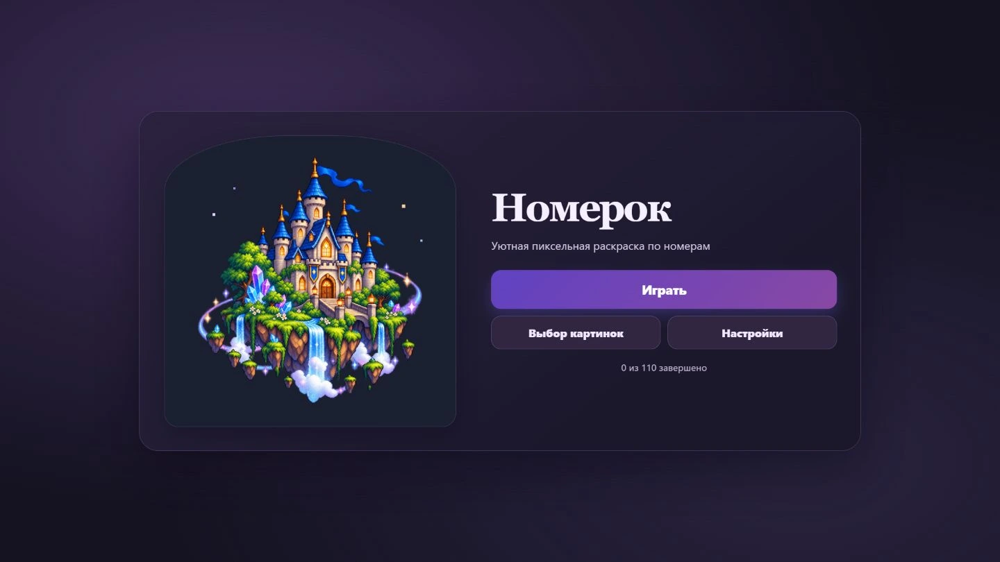

# Номерок / Numbi

Пиксельная раскраска по номерам. Выберите картинку в каталоге, увеличьте нужный участок и закрасьте клетки цветами из палитры.

- 110 иллюстраций с сетками от 30×30 до 90×90.
- Подсказки, сохранение прогресса и сенсорное управление.
- TypeScript, React и Vite.

## Запуск

```bash
npm ci
npm run dev
```

Перед первым `npm test` выполните `npm run build:levels`.

## Скриншоты




